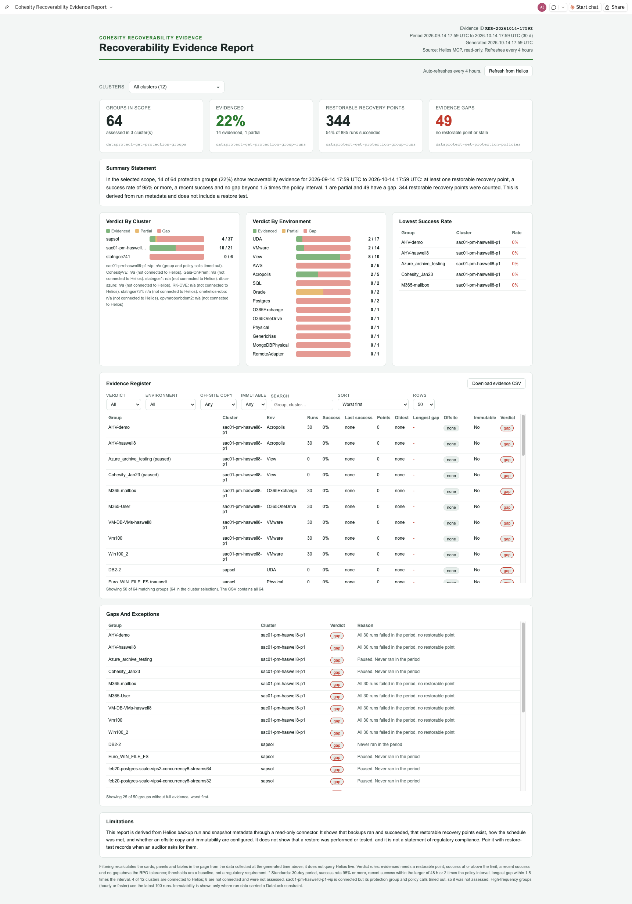

# Cohesity Recoverability Evidence Report

**Author:** Akshay Kumar, Dir, Solutions Architecture ([akshay.kumar2@cohesity.com](mailto:akshay.kumar2@cohesity.com))

A Claude skill, also available as a Microsoft Copilot Studio agent, that turns live Helios run and snapshot metadata into an audit-ready **recoverability evidence report**, published as a live, private Claude Artifact that refreshes every 4 hours. For every protection group in scope it shows, over a reporting period (default 30 days), the success rate, restorable recovery points, newest and oldest recovery point, RPO gaps against the policy schedule, offsite copy status and immutability, and gives an **Evidenced / Partial / Gap** verdict.

- Claude skill: [`claude/Cohesity-Recoverability-Evidence-Report/SKILL.md`](claude/Cohesity-Recoverability-Evidence-Report/SKILL.md) (the full page template is embedded in it)
- Output: one claude.ai **Artifact** titled `Cohesity Recoverability Evidence Report` (no static HTML file), with a **Download evidence CSV** button
- Refresh: scheduled task `cohesity-recoverability-evidence-refresh`, cron `0 */4 * * *`
- Data source: the **Helios MCP server** (`helios-mcp` connector). Everything is read-only.

## Two Versions

| | Claude skill | Microsoft Copilot Studio agent |
|---|---|---|
| Folder | [`claude/`](claude/Cohesity-Recoverability-Evidence-Report/SKILL.md) | [`copilot-studio/`](copilot-studio/README.md) |
| Output | Live, private Claude Artifact, refreshed every 4 hours | Answers in chat, with tables, on demand |
| Helios access | `helios-mcp` connector, read-only | Helios MCP server added as a tool, read-only |
| Setup | Install the skill in Claude (see Install below) | Paste `instructions.md`, upload `knowledge/` files, add the Helios MCP tool |
| Screenshot | Below | Not applicable (chat answers) |

The sections below describe the Claude skill unless a heading says Copilot Studio.

## What this report proves, and what it does not

Helios MCP is read-only, so the report is derived from backup run and snapshot metadata. It shows that backups ran and succeeded, that restorable recovery points exist, how the schedule was met, and whether an offsite copy and immutability are configured. It does **not** show that a restore was performed or tested, and it is **not** a statement of compliance with DORA, SOC 2, HIPAA, ISO 27001 or any other standard. Pair it with restore-test records when an auditor asks for them. The page carries a Limitations card saying exactly this.

## What you get

| Area | What it shows | Helios MCP tool |
|---|---|---|
| Evidence header | Evidence ID (`RER-YYYYMMDD-HHMMZ`), reporting period, generated time | n/a |
| Cluster filter | Multi-select; everything below recalculates in the browser | `dataprotect-get-clusters` |
| Register filters | Verdict, environment, offsite, immutable and search filters, a sort dropdown and a rows selector (default 50) on the evidence register. The CSV export always contains every group in the cluster selection. | none (client-side) |
| KPI cards | Groups in scope, Evidenced %, Restorable recovery points, Evidence gaps | `dataprotect-get-protection-groups`, `dataprotect-get-protection-group-runs` |
| Summary statement | Plain-language statement generated from the selected scope | n/a |
| Verdict by cluster and environment | Stacked evidenced / partial / gap | `dataprotect-get-protection-group-runs` |
| Lowest success rate | Five groups with the lowest success rate | `dataprotect-get-protection-group-runs` |
| Evidence register | Per group: runs, success %, last success, recovery points, oldest point, longest gap vs RPO, offsite copy, immutable, verdict. Verdict filter (All / Gap / Partial / Evidenced), up to 50 rows | `dataprotect-get-protection-group-runs`, `dataprotect-get-protection-policies` |
| Gaps and exceptions | Reason for every group that is not fully evidenced | same |
| Evidence CSV | All groups in the cluster selection, with the evidence ID and period in the first line | page `downloads` capability |

## Verdict rules (defaults, overridable)

`periodDays 30`, `minSuccessPct 95`, `rpoTolerance 1.5`. These are the skill's baseline, not a regulatory requirement; tell Claude your own ("last 90 days, 99%") and it uses them and says so in the footnote. For each active protection group, with `freqH` the policy interval in hours and `staleH = max(48, 2 x freqH)`:

| Verdict | Rule |
|---|---|
| **Evidenced** | At least one restorable recovery point in the period, success rate at or above the limit, last success within `staleH`, longest gap between successes no more than `rpoTolerance x freqH` |
| **Partial** | Has a restorable point and a recent success, but the success rate or the gap rule is not met |
| **Gap** | No restorable point in the period, or the last success is older than `staleH`, or the group never ran |

Paused groups are judged by the same rules and noted as paused.

## Requirements

- Claude desktop app (Cowork) with the **Helios MCP** connector (Controlled Availability: ask your Cohesity account team to enable it).
- Artifacts, the artifact `downloads` capability and scheduled tasks available. Scheduled tasks run only while the Claude app is open.

## Install

1. Zip the folder `claude/Cohesity-Recoverability-Evidence-Report` so `SKILL.md` is inside it.
2. Add it as a custom skill in Claude (Settings, Skills, upload) or copy it into your skills directory.
3. Confirm the Helios MCP connector is connected.

## Use

- "Build the Cohesity recoverability evidence report"
- "Give me recoverability evidence for the last 90 days"
- "Which protection groups have no restorable recovery point?"
- "Refresh the evidence report"

Each refresh produces a new evidence ID. If an auditor needs a frozen report, download the CSV from the page or ask for a one-off run. The page is private until you share it from its Share menu.

## Notes from live testing

Validated on a lab Helios tenant on 2026-10-13: 63 protection groups assessed across 3 clusters, 435 restorable recovery points, 15 groups evidenced and 48 with a gap (mostly never-run or paused groups), one cluster whose group query kept timing out and was reported as not assessed. Lessons built into the skill:

- `includeObjectDetails: true` is required for the per-run `isLocalSnapshotsDeleted` flag; it makes big responses, which are processed from file.
- Database groups (DB2, Oracle, SAP HANA) produce hundreds of log runs that swamp the counts, so log runs are ignored and the scope note says so.
- `totalRuns` ignores filters; use the returned `runs.length`. Hourly groups exceed the 100-run page, so paging is capped and the gap check starts at the oldest run actually read.
- Cloud-archive-direct groups have no `localBackupInfo`: archive results are used instead, and a copy counts only if it has not expired.
- Archive copies that are only `Accepted` or `Skipped` are not counted as an offsite copy.

## Manual refresh

The page header has a **Refresh from Helios** button. A published page cannot call Helios on its own, so the button copies `Run the Cohesity-Recoverability-Evidence-Report skill to refresh this report from live Helios data`; paste it into Claude to pull live data and republish the same artifact, then reopen or refresh the tab. The scheduled task (every 4 hours) and this command are the two refresh paths.

## If the artifact was deleted

If the stored artifact URL no longer exists, the skill republishes the page as a new artifact and says so in its reply, so a deleted page never blocks a refresh. Update the scheduled task prompt with the new link.

## When Helios is unreachable

If `helios-mcp` is down or its token has expired, a scheduled refresh does not clear the page. It keeps the last successful data and adds a red banner, "Unable to connect to Helios. Showing the last successful data.", under the header. The next successful refresh removes the banner.

## Known limits

- Evidence comes from metadata; no restore is performed or verified.
- Groups on clusters that are not connected to Helios, or whose queries time out, are not assessed and are listed as such.
- Capped paging on very busy groups is flagged in the footnote.

## Screenshots (Claude Version)



_Captured from the published artifact; cluster and group names are lab data._

## Microsoft Copilot Studio Version

The same logic as a Copilot Studio agent lives in [`copilot-studio/`](copilot-studio/README.md): `instructions.md` (agent instructions), `knowledge/` (two files to upload as Knowledge), `starters.md` (conversation starters) and step-by-step setup. It answers in chat and does not publish a page, schedule itself, or offer a cluster picker or CSV button. Add your Helios MCP server as a tool and enable only the read-only tools.

## Repository layout

```
Cohesity-Recoverability-Evidence-Report/
  README.md
  claude/
    Cohesity-Recoverability-Evidence-Report/SKILL.md      Claude skill (install this folder in Claude)
  copilot-studio/
    README.md          setup steps
    instructions.md    agent instructions
    knowledge/         files to upload as Knowledge
    starters.md        conversation starters
  docs/
    screenshots/recoverability-evidence-report.png
```
