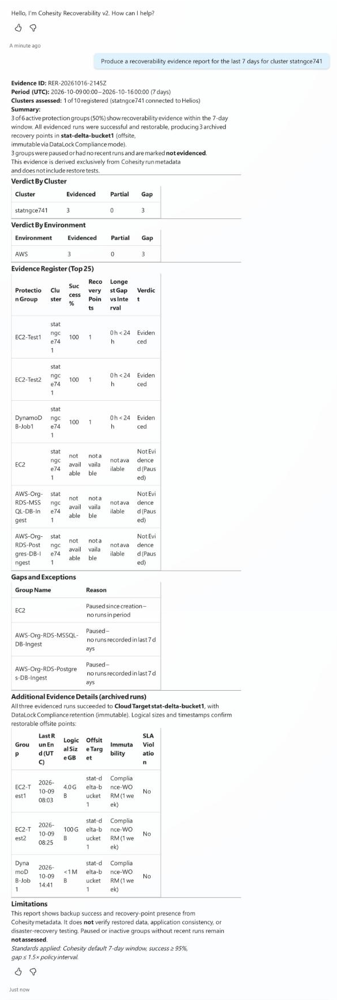

# Cohesity Recoverability Evidence Agent For Microsoft Copilot Studio

Recoverability evidence over a reporting period, as a Copilot Studio agent. This is the same logic as the Claude skill in `../claude/`, rewritten as agent instructions and knowledge files.

## Sample output

**Prompt:** `Produce a recoverability evidence report for the last 7 days for cluster statngce741`

**Model:** GPT-5 Chat. Lab data. Captured in the Copilot Studio test pane in Light mode.

### Notes

| Topic | Note |
|---|---|
| Format | The answer is chat text with tables. The Claude skill gives a live, filterable page. See the sample in [claude/README.md](../claude/README.md). |
| Scope | Name one cluster and a short period. A 30 day report on a large cluster can exceed the tool limits. |
| Evidence | The report is built from run metadata. It does not prove that a restore works. |
| Accuracy | The agent follows the instructions but is a language model. Compare a few answers with Helios before you share the agent. |
| Your data | Cluster and group names in the image are lab data. Your answers will differ. |

## What is in this folder

| File | Where it goes in Copilot Studio |
|---|---|
| `instructions.md` | Agent, Overview, Instructions (under the 8,000 character limit) |
| `knowledge/evidence-report-methodology.md` | Agent, Knowledge, Add knowledge, Upload file |
| `knowledge/helios-mcp-tool-notes.md` | Agent, Knowledge, Add knowledge, Upload file |
| `starters.md` | Example prompts to try in the test pane |

## Agent settings

| Setting | Value |
|---|---|
| Agent name | Cohesity Recoverability Evidence |
| Model | GPT-5 Chat |
| Instructions | The content of `instructions.md` |
| Knowledge | Both files in `knowledge/` |
| Web Search | Disabled |
| Tool | Helios MCP server (Model Context Protocol), read-only tools only |

## Setup

1. In Copilot Studio, choose **Agents**, then **Create blank agent**, and wait until the agent shows **Provisioned**.
2. On **Overview**, under **Select your agent's model**, select **GPT-5 Chat**.
3. Under **Instructions**, choose **Edit**, paste the full content of `instructions.md`, and choose **Save**.
4. Under **Knowledge**, choose **Add knowledge**, **Upload file**, upload both files from `knowledge/`, and choose **Add to agent**. Keep **Web Search** disabled.
5. Open the **Tools** tab, choose **Add a tool**, filter on **Model Context Protocol**, select your Helios MCP server, and choose **Add and configure**. Enable only the read-only tools listed in `knowledge/helios-mcp-tool-notes.md`.
6. Choose **Test** and try a prompt from `starters.md`. Then choose **Publish** and add the channels you need on the **Channels** page.

Example prompts:

- Produce a recoverability evidence report for the last 30 days
- Produce a recoverability evidence report for the last 7 days for cluster <cluster name>
- Which protection groups have an evidence gap and why?
- Evidence report for the last 90 days with a 98% success threshold
- Which groups have no offsite copy or no immutability?

Name one cluster in the prompt for the best result. Large periods on large clusters can exceed the tool limits.

## Differences from the Claude skill

| Area | Claude skill | Copilot Studio agent |
|---|---|---|
| Output | Live page that refreshes every 4 hours | Chat answer with tables, on demand |
| Cluster choice | Multi-select on the page | Name the cluster in your question |
| Schedule | Scheduled task in Claude | Power Automate flow with a schedule trigger (not part of this folder) |
| Large Helios responses | Processed with code | Can be slow or hit tool limits on big estates. Ask for one cluster at a time. |
| CSV | Copy and download buttons | Ask for a CSV block in chat and copy it |
| Access | Read-only | Read-only |

## Check before you publish

Share the agent only with people who may see backup data for the connected clusters. The agent follows the instructions but is a language model, not a fixed report. Ask a few known questions first and compare the answers with Helios.
